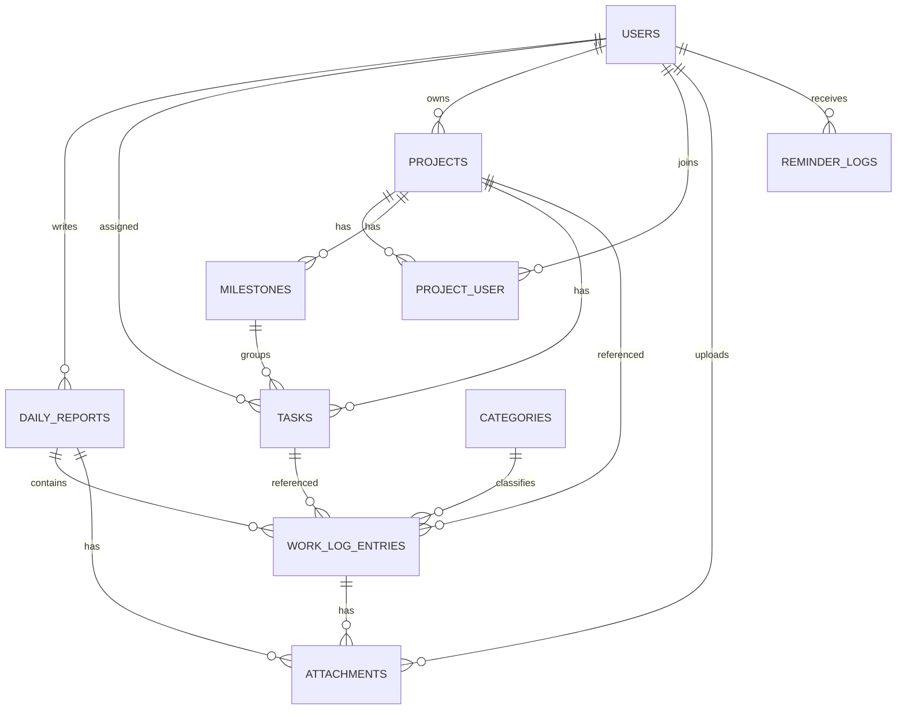

# IT Worklog — ERD & Skema Database

Status: Planning v1.1  
Tanggal: 23 Oktober 2026  
Database: MySQL 8 / MariaDB 10.4+  
Engine: InnoDB, utf8mb4

## 0. Perubahan v1.1

- `daily_reports`: `summary` diganti `notes` opsional; `total_minutes` dihapus.
- `work_log_entries`: `duration_minutes` dihapus; `category_id` menjadi opsional.
- `users`: `daily_target_minutes` dihapus.
- `settings`: `daily_target_minutes` dihapus.
- `tasks`: `estimate_minutes` dihapus.
- Laporan dan dashboard memakai jumlah pekerjaan, bukan total jam.
- Worklog valid jika memiliki minimal satu pekerjaan aktif.

## 1. Prinsip Desain

- Primary key `bigint unsigned`.
- Foreign key memakai `restrict` untuk data historis.
- Timestamp disimpan UTC; `report_date` berupa `DATE` lokal Asia/Jakarta.
- Enum disimpan sebagai `varchar` + PHP backed enum, bukan `ENUM` MySQL.
- Satu tim IT, sehingga tidak ada tabel `teams`; scope manager adalah seluruh user aktif.
- Audit memakai `spatie/laravel-activitylog`.
- Lampiran disimpan di disk privat dan diakses melalui route ber-Policy.
- Soft delete digunakan pada data yang perlu dipulihkan.
- Tidak ada kolom durasi, jam mulai, jam selesai, atau target jam di MVP.

## 2. Daftar Tabel

Tabel aplikasi:

1. `users`
2. `settings`
3. `categories`
4. `projects`
5. `project_user`
6. `milestones`
7. `tasks`
8. `daily_reports`
9. `work_log_entries`
10. `attachments`
11. `reminder_logs`
12. `activity_log`

Tabel bawaan Laravel: `password_reset_tokens`, `sessions`, `cache`, `cache_locks`, `jobs`, `job_batches`, `failed_jobs`.

## 3. Detail Tabel

### users

| Kolom | Tipe | Null | Default | Catatan |
|---|---|---|---|---|
| id | bigint unsigned | no | auto | PK |
| name | varchar(255) | no | | |
| email | varchar(255) | no | | unique |
| password | varchar(255) | no | | hashed |
| role | varchar(20) | no | member | index |
| position | varchar(100) | yes | null | jabatan |
| is_active | boolean | no | true | index |
| last_login_at | timestamp | yes | null | |
| remember_token | varchar(100) | yes | null | |
| created_at | timestamp | yes | null | |
| updated_at | timestamp | yes | null | |

### settings

Satu baris dengan `id = 1`.

| Kolom | Tipe | Null | Default | Catatan |
|---|---|---|---|---|
| id | tinyint unsigned | no | 1 | PK |
| app_name | varchar(100) | no | IT Worklog | |
| timezone | varchar(64) | no | Asia/Jakarta | |
| workdays | json | no | [1,2,3,4,5,6] | 1=Senin |
| reminder_time | time | no | 17:00 | |
| mail_from_address | varchar(255) | yes | null | |
| mail_from_name | varchar(100) | yes | null | |
| created_at | timestamp | yes | null | |
| updated_at | timestamp | yes | null | |

### categories

| Kolom | Tipe | Null | Default | Catatan |
|---|---|---|---|---|
| id | bigint unsigned | no | auto | PK |
| name | varchar(100) | no | | unique |
| color | char(7) | no | #6B7280 | format hex |
| is_active | boolean | no | true | index |
| sort_order | smallint unsigned | no | 0 | |
| created_at | timestamp | yes | null | |
| updated_at | timestamp | yes | null | |

Kategori awal: Development, Support, Meeting, Maintenance, Umum.

### projects

| Kolom | Tipe | Null | Default | Catatan |
|---|---|---|---|---|
| id | bigint unsigned | no | auto | PK |
| code | varchar(32) | no | | unique |
| name | varchar(255) | no | | |
| description | text | yes | null | |
| status | varchar(20) | no | planning | index |
| owner_id | bigint unsigned | no | | FK users, restrict |
| start_date | date | yes | null | |
| due_date | date | yes | null | |
| completed_at | timestamp | yes | null | |
| created_at | timestamp | yes | null | |
| updated_at | timestamp | yes | null | |
| deleted_at | timestamp | yes | null | soft delete |

### project_user

| Kolom | Tipe | Null | Default | Catatan |
|---|---|---|---|---|
| id | bigint unsigned | no | auto | PK |
| project_id | bigint unsigned | no | | FK projects, cascade |
| user_id | bigint unsigned | no | | FK users, cascade |
| role_in_project | varchar(20) | no | member | |
| created_at | timestamp | yes | null | |
| updated_at | timestamp | yes | null | |

Unique: `(project_id, user_id)`.

### milestones

| Kolom | Tipe | Null | Default | Catatan |
|---|---|---|---|---|
| id | bigint unsigned | no | auto | PK |
| project_id | bigint unsigned | no | | FK projects, cascade |
| title | varchar(255) | no | | |
| description | text | yes | null | |
| due_date | date | yes | null | |
| status | varchar(20) | no | pending | index |
| completed_at | timestamp | yes | null | |
| sort_order | smallint unsigned | no | 0 | |
| created_at | timestamp | yes | null | |
| updated_at | timestamp | yes | null | |
| deleted_at | timestamp | yes | null | soft delete |

### tasks

| Kolom | Tipe | Null | Default | Catatan |
|---|---|---|---|---|
| id | bigint unsigned | no | auto | PK |
| project_id | bigint unsigned | no | | FK projects, cascade |
| milestone_id | bigint unsigned | yes | null | FK milestones, null on delete |
| assignee_id | bigint unsigned | yes | null | FK users, null on delete |
| created_by_id | bigint unsigned | no | | FK users, restrict |
| title | varchar(255) | no | | |
| description | text | yes | null | |
| status | varchar(20) | no | todo | index |
| priority | varchar(10) | no | normal | index |
| due_date | date | yes | null | index |
| started_at | timestamp | yes | null | |
| completed_at | timestamp | yes | null | |
| created_at | timestamp | yes | null | |
| updated_at | timestamp | yes | null | |
| deleted_at | timestamp | yes | null | soft delete |

Tidak ada `estimate_minutes` di MVP.

### daily_reports

| Kolom | Tipe | Null | Default | Catatan |
|---|---|---|---|---|
| id | bigint unsigned | no | auto | PK |
| user_id | bigint unsigned | no | | FK users, restrict |
| report_date | date | no | | |
| notes | text | yes | null | catatan atau blocker |
| first_submitted_at | timestamp | yes | null | |
| last_edited_at | timestamp | yes | null | |
| created_at | timestamp | yes | null | |
| updated_at | timestamp | yes | null | |
| deleted_at | timestamp | yes | null | soft delete |
| active | tinyint generated | yes | | 1 jika belum dihapus |

Definisi kolom generated:

```sql
active TINYINT GENERATED ALWAYS AS (IF(deleted_at IS NULL, 1, NULL)) STORED
UNIQUE (user_id, report_date, active)
```

Tujuannya: satu laporan aktif per user per tanggal, tetapi beberapa laporan terhapus tetap dapat disimpan untuk restore.

Laporan dianggap terisi jika memiliki minimal satu `work_log_entries` aktif. `notes` saja tidak membuat laporan dianggap terisi.

### work_log_entries

| Kolom | Tipe | Null | Default | Catatan |
|---|---|---|---|---|
| id | bigint unsigned | no | auto | PK |
| daily_report_id | bigint unsigned | no | | FK daily_reports, cascade |
| project_id | bigint unsigned | yes | null | FK projects, restrict |
| task_id | bigint unsigned | yes | null | FK tasks, restrict |
| category_id | bigint unsigned | yes | null | FK categories, restrict |
| description | text | no | | pekerjaan yang dilakukan |
| sort_order | smallint unsigned | no | 0 | |
| created_at | timestamp | yes | null | |
| updated_at | timestamp | yes | null | |
| deleted_at | timestamp | yes | null | soft delete |

Tidak ada `duration_minutes`.

### attachments

| Kolom | Tipe | Null | Default | Catatan |
|---|---|---|---|---|
| id | bigint unsigned | no | auto | PK |
| attachable_type | varchar(255) | no | | morph |
| attachable_id | bigint unsigned | no | | morph |
| user_id | bigint unsigned | no | | FK users, restrict |
| disk | varchar(50) | no | local | |
| path | varchar(255) | no | | path privat |
| original_name | varchar(255) | no | | |
| mime_type | varchar(100) | no | | |
| size | bigint unsigned | no | | byte |
| created_at | timestamp | yes | null | |
| updated_at | timestamp | yes | null | |
| deleted_at | timestamp | yes | null | soft delete |

Index: `(attachable_type, attachable_id)` dan `user_id`.

Lampiran dapat menempel pada `work_log_entries` atau `daily_reports`.

### reminder_logs

| Kolom | Tipe | Null | Default | Catatan |
|---|---|---|---|---|
| id | bigint unsigned | no | auto | PK |
| user_id | bigint unsigned | no | | FK users, cascade |
| reminder_date | date | no | | |
| status | varchar(20) | no | sent | sent, failed, skipped |
| sent_at | timestamp | yes | null | |
| error | text | yes | null | |
| created_at | timestamp | yes | null | |
| updated_at | timestamp | yes | null | |

Unique: `(user_id, reminder_date)`.

### activity_log

Tabel dari `spatie/laravel-activitylog`.

| Kolom | Tipe | Catatan |
|---|---|---|
| id | bigint unsigned | PK |
| log_name | varchar(255) | worklog, project, task |
| description | text | |
| subject_type | varchar(255) | |
| subject_id | bigint unsigned | |
| causer_type | varchar(255) | |
| causer_id | bigint unsigned | |
| properties | json | menyimpan old dan new |
| batch_uuid | uuid | |
| event | varchar(255) | created, updated, deleted, restored |
| created_at | timestamp | |
| updated_at | timestamp | |

Index: subject, causer, event, dan `created_at`.

## 4. Enum PHP

```php
enum UserRole: string { case Admin = 'admin'; case Manager = 'manager'; case Member = 'member'; }
enum ProjectStatus: string { case Planning = 'planning'; case Active = 'active'; case OnHold = 'on_hold'; case Completed = 'completed'; case Cancelled = 'cancelled'; }
enum MilestoneStatus: string { case Pending = 'pending'; case InProgress = 'in_progress'; case Completed = 'completed'; }
enum TaskStatus: string { case Todo = 'todo'; case InProgress = 'in_progress'; case Blocked = 'blocked'; case Done = 'done'; }
enum TaskPriority: string { case Low = 'low'; case Normal = 'normal'; case High = 'high'; case Urgent = 'urgent'; }
enum ReminderStatus: string { case Sent = 'sent'; case Failed = 'failed'; case Skipped = 'skipped'; }
```

## 5. Relasi

- User hasMany DailyReport
- User hasMany Task sebagai assignee
- User hasMany Project sebagai owner
- User belongsToMany Project melalui `project_user`
- Project belongsTo User sebagai owner
- Project belongsToMany User sebagai members
- Project hasMany Milestone
- Project hasMany Task
- Project hasMany WorkLogEntry
- Milestone belongsTo Project
- Milestone hasMany Task
- Task belongsTo Project, Milestone, Assignee, Creator
- Task hasMany WorkLogEntry
- DailyReport belongsTo User
- DailyReport hasMany WorkLogEntry
- DailyReport morphMany Attachment
- WorkLogEntry belongsTo DailyReport, Project, Task, Category
- WorkLogEntry morphMany Attachment
- Attachment morphTo Attachable
- Attachment belongsTo User
- ReminderLog belongsTo User

## 6. ERD



## 7. Index Penting

| Kebutuhan query | Index |
|---|---|
| Feed tim per tanggal | `daily_reports(report_date, user_id)` |
| Riwayat user | unique `(user_id, report_date, active)` |
| Pekerjaan per laporan | `work_log_entries(daily_report_id)` |
| Task per project/status | `tasks(project_id, status)` |
| Tugas saya | `tasks(assignee_id, status)` |
| Deadline dan overdue | `tasks(due_date)` |
| Laporan per project | `work_log_entries(project_id)` |
| Laporan per kategori | `work_log_entries(category_id)` |
| Lampiran | `attachments(attachable_type, attachable_id)` |
| Audit | `activity_log(subject_type, subject_id)` dan `(causer_id, created_at)` |
| Reminder idempoten | unique `reminder_logs(user_id, reminder_date)` |

## 8. Urutan Migration

1. Bawaan Laravel: `users`, `password_reset_tokens`, `sessions`
2. Bawaan Laravel: `cache`, `cache_locks`
3. Bawaan Laravel: `jobs`, `job_batches`, `failed_jobs`
4. `settings`
5. `categories`
6. `projects`
7. `project_user`
8. `milestones`
9. `tasks`
10. `daily_reports`
11. `work_log_entries`
12. `attachments`
13. `reminder_logs`
14. `activity_log` dari package spatie

## 9. Aturan Hapus dan Histori

- User tidak dihapus, hanya `is_active = false`.
- Kategori tidak dihapus, hanya `is_active = false`.
- Project, milestone, task, daily report, pekerjaan, dan attachment memakai soft delete.
- Menghapus pekerjaan terakhir otomatis melakukan soft delete pada laporan harian.
- Memulihkan laporan tidak otomatis memulihkan pekerjaan yang sudah dihapus.
- Worklog historis tetap menampilkan project/task yang sudah dihapus dengan `withTrashed()`.
- Hard delete ditolak jika masih direferensikan worklog (`restrictOnDelete`).
- File lampiran yang soft-deleted dipertahankan; pembersihan file fisik menjadi tugas terjadwal fase berikutnya.

## 10. Catatan Implementasi

- Jumlah pekerjaan dihitung dengan `withCount('entries')`, bukan agregasi durasi.
- Progress project dihitung dengan `withCount`, belum didenormalisasi.
- Kepatuhan dihitung dari hari kerja yang memiliki laporan dengan minimal satu pekerjaan aktif.
- Reminder dicek per menit oleh scheduler dan hanya dikirim jika `reminder_logs` belum ada.
- Attachment diakses melalui route ber-Policy; tidak ada symlink publik.
- Jika nanti butuh time tracking, tambahkan `duration_minutes` nullable ke `work_log_entries`; data lama tetap valid.
- Jika nanti butuh multi-tim, tambahkan `team_id` ke `users` dan `projects`, lalu sesuaikan Policy.
